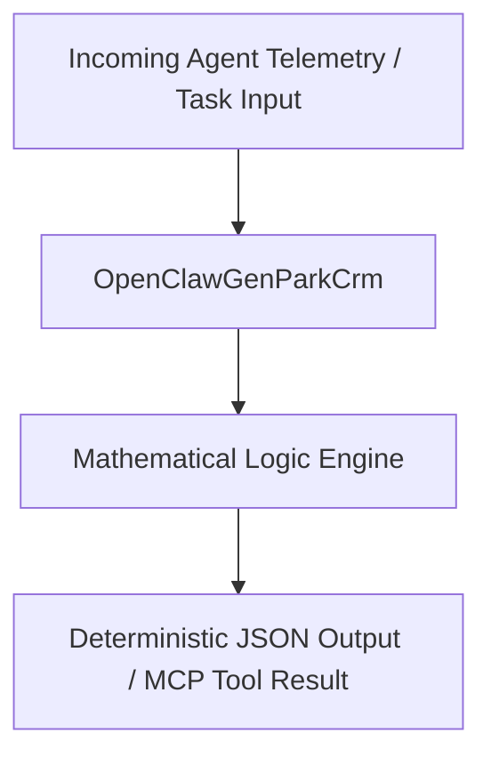

# openclaw-genpark-crm

[](https://github.com/alphaparkinc)
[](https://modelcontextprotocol.io)
[](#)
[](#)
[](#)
[](LICENSE)

Production-hardened OpenClaw GenPark Agent skill engineered strictly with Python standard library. Provides high-throughput deterministic execution, cryptographic security, and game-theoretic optimization via the Model Context Protocol (MCP).

---

## Architecture & Data Flow



---

## Quickstart & Usage

### 1. Direct Python Client Execution
```bash
python example_usage.py
```

### 2. Standalone MCP Server Launch
Run the native STDIO MCP server:
```bash
python mcp_server.py
```

---

## License

This project is licensed under the MIT License - see the [LICENSE](LICENSE) file for details.
